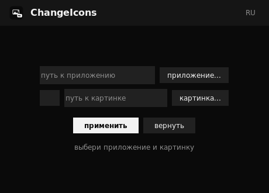

<div align="center">


# ChangeIcons



Захотел свою иконку у программы — пожалуйста. Кидаешь любую картинку, утилита делает из неё иконку, подставляет её приложению и запоминает, как было. Передумал — вернул одной кнопкой. Работает на Linux и Windows.

[](https://python.org)
[](https://python-pillow.org)
[](LICENSE)

</div>

## Зачем

Стандартные иконки быстро надоедают, а вручную лезть в системные папки и редактировать файлы — то ещё удовольствие. ChangeIcons закрывает этот вопрос за три клика: выбрал файл приложения, выбрал картинку, нажал «применить». Интерфейс на русском и английском, переключается на месте.

## Что посмотреть перед использованием

Ничего страшного под капотом не происходит: системные файлы не переписываются. На Linux создаётся копия `.desktop`-файла с твоей иконкой в пользовательской папке — она выходит на первый план, а оригинал остаётся нетронутым, поэтому «вернуть» просто убирает копию. На Windows у ярлыка меняется путь к иконке, а при правке самого `.exe` заранее сохраняется его полная копия.

Всё, что менялось, лежит в `~/.local/share/changeicons` (на Windows — в `%APPDATA%\ChangeIcons`). Удалил папку с бэкапом — об откате забудь, лучше не удаляй.

## Установка и запуск

Нужен Python 3.10+.

```bash
git clone https://github.com/linux15404/ChangeIcons.git
cd ChangeIcons
python3 -m venv .venv
source .venv/bin/activate
pip install .
python -m changeicons
```

На Windows `pywin32` поставится сам вместе с пакетом — он нужен только для работы с `.exe` и `.lnk`.

## Как устроено внутри

Три слоя, каждый занимается своим:

- **core** — вся логика: нарезка картинок (Pillow), поиск приложений, бэкапы;
- **platforms** — различия систем: Linux переопределяет `.desktop` (включая Flatpak и Snap), Windows правит ярлыки и вшивает иконку в `.exe`;
- **gui** — окно на tkinter, только рисует и передаёт запросы.

Так проще жить: ядро не знает ни про кнопки, ни про операционку, а добавить поддержку третьей системы — это один новый файл в `platforms/`.

## Лицензия

MIT — см. [LICENSE](LICENSE).
